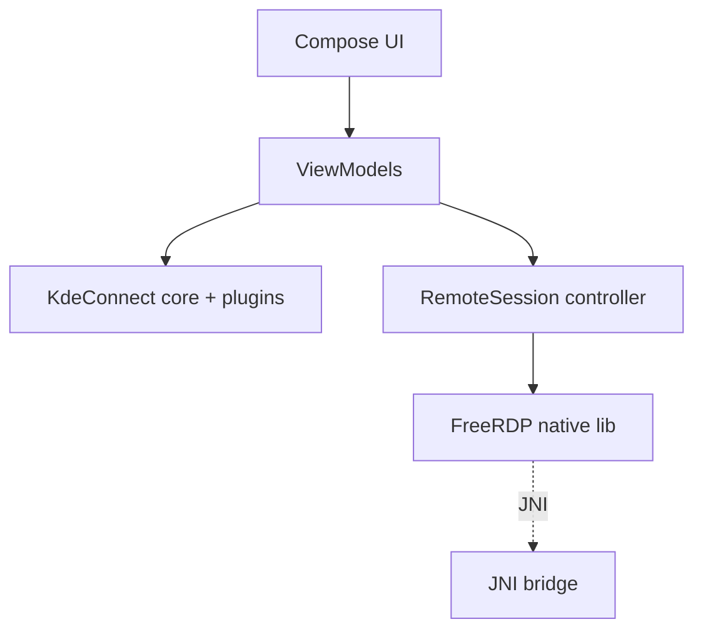

# Android architecture

`twinelink-android` is a hard fork of KDE Connect for Android, rewritten to
Jetpack Compose and extended with the Twine features.

## Stack

- Kotlin, Jetpack Compose, Material 3.
- The existing KDE Connect Android core/plugins are retained as the control
  plane.
- An embedded **FreeRDP** client (via NDK) provides the remote session.

## Structure

## Native build

FreeRDP plus OpenSSL and OpenH264 are built for the Android ABIs and packaged
into the APK (C-5). See [build android](../development/build-android.md).

## Features added

- Wake-on-LAN sender (same LAN; relay guidance otherwise).
- One-tap remote desktop (request session over control plane, then FreeRDP).

## UI migration

Legacy XML/Activity screens move to Compose incrementally (M-A2). Existing
plugin screens are ported without changing their backend.
