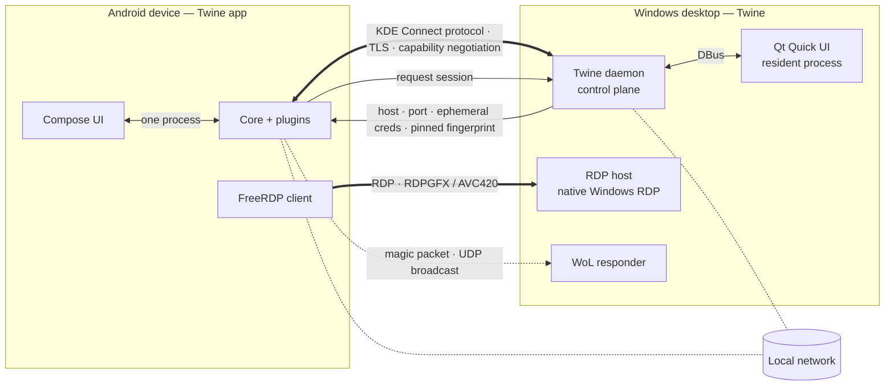
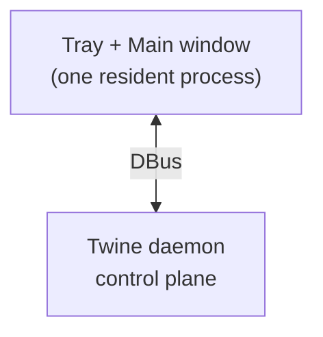

# Architecture overview

Twine separates **control** from **transport**. The trusted Twine connection
carries intent; heavy media flows over a dedicated transport that Twine
orchestrates but does not implement.

## Planes

### Control plane

The KDE Connect protocol, unchanged. It provides pairing (mutual TLS),
discovery (UDP 1716 + mDNS), a capability/packet negotiation channel, and the
plugin system that powers clipboard, file transfer, notifications, media and
input. **Protocol identifiers remain `kdeconnect.*`** — this is what keeps
interoperability with stock KDE Connect (see
[protocol interop](./protocol.md)).

The control plane is extended with Twine capabilities:

- `twinelink.wol.info` — host offers MAC + broadcast address.
- `twinelink.remote.session` — host orchestrates an RDP session and returns the
  connection parameters.

### Transport plane

A dedicated, pluggable session transport. **FreeRDP** is the first provider;
VNC and Moonlight follow behind one interface (see
[transport abstraction](./transport.md)). The control plane never carries
video — it only negotiates.

## Components

| Component | Repo | Role |
| --- | --- | --- |
| Twine desktop | `twinelink-desktop` | Daemon (control plane) + resident Qt Quick UI + RDP host orchestration + WoL responder |
| Twine Android | `twinelink-android` | Compose UI + core + embedded FreeRDP client + WoL sender |
| Docs & specs | `twinelink-docs` | This site, OpenSpec store, architecture, requirements, roadmap |
| Meta | `twinelink` | Submodule superproject tying the repos together |

## Process model (desktop)

The desktop deliberately collapses what upstream KDE Connect splits into
`kdeconnectd` + `kdeconnect-indicator` + `kdeconnect-app`: **one resident
process** hosts the daemon, the tray, and the window, so opening the UI costs no
process spawn. See
[startup performance](./startup-performance.md) for the reasoning and evidence.
