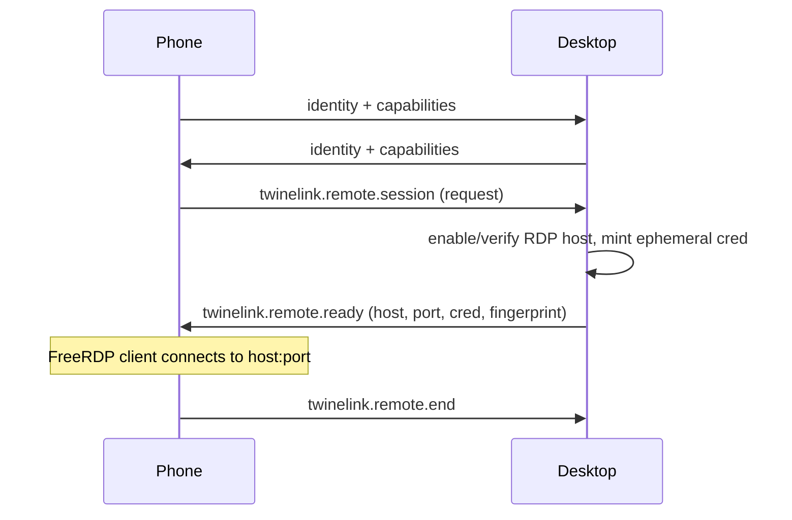

# Protocol & interoperability

twinelink speaks the **KDE Connect protocol** on the control plane. This is a
deliberate constraint (C-10): the wire format and identifiers stay `kdeconnect.*`
so a twinelink device interoperates with a stock KDE Connect peer.

## What stays unchanged

- Packet types (`kdeconnect.clipboard`, `kdeconnect.ping`, ...).
- Capability names exchanged during the handshake.
- Pairing, TLS and discovery.
- Device identity and identity files.

## What twinelink adds

New capabilities are additive. A peer that does not advertise them simply never
receives those packets, so the feature hides gracefully (FR-41).

| Capability                 | Direction               | Purpose                           |
| -------------------------- | ----------------------- | --------------------------------- |
| `twinelink.wol.info`       | desktop to phone        | expose MAC + broadcast address    |
| `twinelink.wol.wake`       | phone to desktop-or-LAN | (LAN fallback) magic packet relay |
| `twinelink.remote.session` | phone to desktop        | request an RDP session            |
| `twinelink.remote.ready`   | desktop to phone        | host/port/creds/fingerprint       |
| `twinelink.remote.end`     | both                    | session teardown                  |

## Handshake

## Compatibility matrix

Maintained in [roadmap](./../plan/roadmap.md) and released per version. A peer
is "compatible" when it speaks the base protocol; twinelink features then depend on
advertised capabilities.

## Discovery note

Discovery (UDP 1716 + mDNS) is unchanged, but twinelink scopes/defer it on Windows
for startup cost reasons (see
[startup performance](./../architecture/startup-performance.md)).
