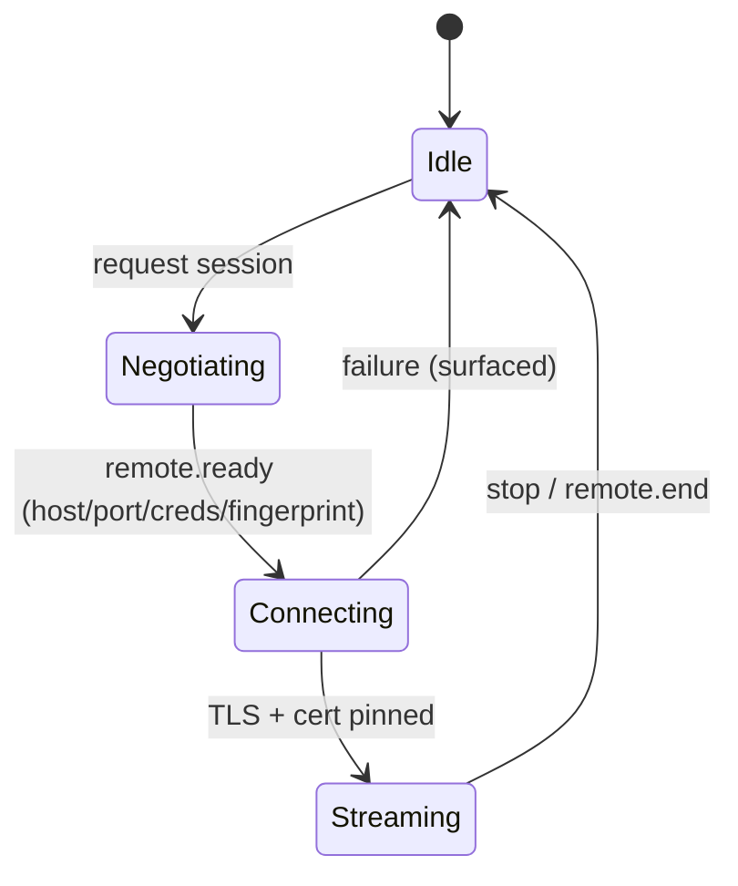

# Transport abstraction

Video and input ride a dedicated transport. The control plane never carries
media. Transports implement one interface so new protocols are added without
touching the core (OCP).

## Interface

```cpp
struct SessionInfo {
    QString host;             // hostname or IP
    quint16 port;
    QString username;
    QString password;         // ephemeral, never persisted
    QString domain;
    QByteArray certFingerprint; // pinned SHA-256
    QVariantMap options;      // provider-specific (codec, resolution...)
};

class RemoteSessionProvider {
public:
    virtual ~RemoteSessionProvider() = default;
    virtual QString id() const = 0;                 // "freerdp", "vnc", "moonlight"
    virtual QStringList capabilities() const = 0;   // e.g. "rdpgfx", "avc420"
    virtual bool canHandle(const SessionInfo &) const = 0;
    virtual void start(const SessionInfo &) = 0;    // begin connect + render
    virtual void stop() = 0;
    virtual void sendInput(const InputEvent &) = 0;
signals:  // Qt signals in the real header
    void connected();
    void frameReady();
    void failed(QString reason);
    void disconnected();
};
```

## Providers

| id | Status | Notes |
| --- | --- | --- |
| `freerdp` | MVP | FreeRDP (Apache-2.0), RDPGFX/AVC420, cert pinning |
| `vnc` | later | libvncclient / TigerVNC |
| `moonlight` | later | low-latency game streaming |

## Security

- The server certificate fingerprint is delivered over the **control plane**
  (mutually authenticated TLS) and pinned by the client (NFR-22, FR-22).
- Credentials are ephemeral with a TTL and are never written to disk (NFR-23).
- Teardown always releases credentials and processes (FR-24, NFR-11).

## Lifecycle


