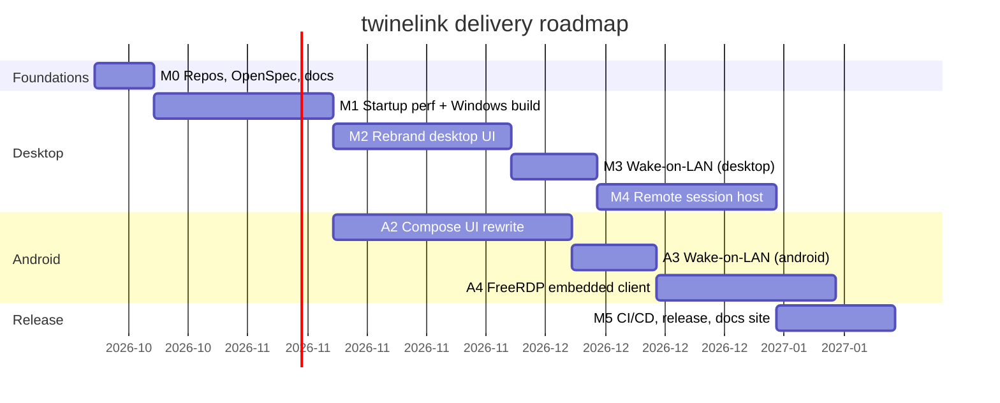

# Roadmap

twinelink is delivered in milestones. Each milestone is a set of OpenSpec changes;
every change has its own proposal, specs, design and checklist under
[milestones](./milestones.md).

## Milestones

| ID  | Milestone                                             | Primary repo(s) | Depends on |
| --- | ----------------------------------------------------- | --------------- | ---------- |
| M0  | Repos, submodules, OpenSpec, docs skeleton            | all             | —          |
| M1  | Desktop startup performance + Windows build off Craft | desktop         | M0         |
| M2  | Rebrand desktop UI (Qt Quick)                         | desktop         | M1         |
| A2  | Android Compose UI rewrite                            | android         | M0         |
| M3  | Wake-on-LAN (desktop side)                            | desktop         | M2         |
| A3  | Wake-on-LAN (android side)                            | android         | A2, M3     |
| M4  | Remote session host orchestration                     | desktop         | M3         |
| A4  | Embedded FreeRDP client                               | android         | A3, M4     |
| M5  | CI/CD hardening, release, docs site                   | all             | M4, A4     |

## Sequencing principle

Each side (desktop / Android) can progress independently until the integration
milestones (A3, M4, A4) where the control-plane capability is exercised
end-to-end. Transport (A4 + M4) is last because it depends on a stable, trusted
control plane and the chosen abstraction.
